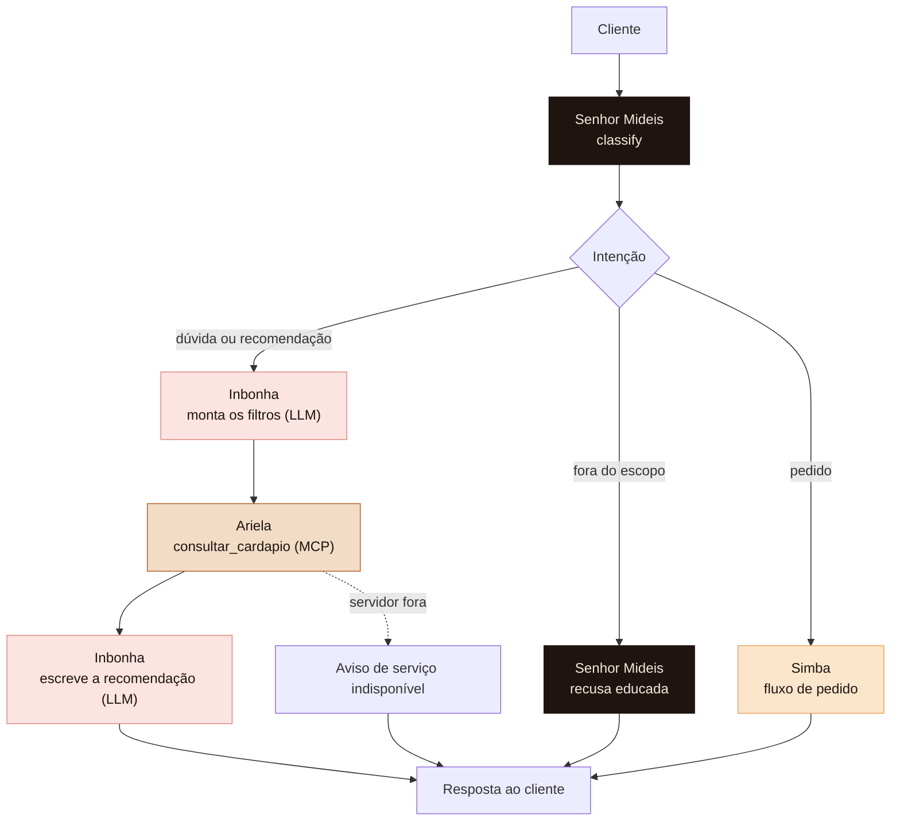
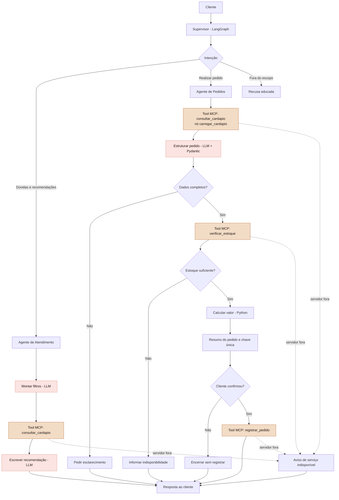

<p align="center">
  <picture>
    <source media="(prefers-color-scheme: dark)" srcset="docs/brand/logo/logo-horizontal-negativo.svg">
    
  </picture>
</p>

<p align="center"><em>Uma cafeteria administrada por gatos (e por agentes de IA).</em></p>

<p align="center">
  
  
  
  
</p>

O Cafeter.IA atende clientes de uma cafeteria por texto: tira dúvidas sobre o cardápio, recomenda produtos e, quando o fluxo de pedido estiver pronto, monta o pedido, confere o estoque, calcula o valor e registra só depois da confirmação do cliente. É um sistema multiagente em Python com LangGraph, saída estruturada com Pydantic e ferramentas expostas por um servidor MCP.

> **Princípio:** a IA interpreta e orienta; as ferramentas executam; o Python valida e calcula; o MCP padroniza a comunicação; o LangGraph coordena.

Projeto em grupo do bootcamp de agentic AI da Deloitte.

## Sumário

1. [Os gatos-agentes](#os-gatos-agentes)
2. [Como funciona](#como-funciona)
3. [O que já funciona](#o-que-já-funciona)
4. [Como rodar](#como-rodar)
5. [Testes](#testes)
6. [Estrutura do repositório](#estrutura-do-repositório)
7. [Regras do projeto](#regras-do-projeto)
8. [Equipe](#equipe)
9. [Documentação](#documentação)

## Os gatos-agentes

Cada agente do sistema tem um gato, uma cor e uma personalidade.

| | Gato | Agente | O que faz |
|---|---|---|---|
|  | **Senhor Mideis** | Supervisor | Classifica a intenção da mensagem e encaminha. Recusa com educação o que foge da cafeteria |
|  | **Inbonha** | Atendimento | Entende o que o cliente procura, consulta o cardápio e recomenda só o que existe |
|  | **Simba** | Pedidos | Estrutura o pedido, calcula o valor e registra depois da confirmação (em construção) |
|  | **Ariela** | Estoque (MCP) | Guarda o cardápio, o estoque e os pedidos no servidor MCP |

## Como funciona

### Fluxo atual



Cada cor é o gato responsável pelo passo. As setas tracejadas mostram o desvio quando o servidor MCP não responde.

### Fluxo completo (com o pedido)

O caminho inteiro planejado, incluindo o fluxo de pedido que ainda está em construção:



Legenda: caramelo = passo que chama o MCP (Ariela); rosa = passo do LLM; sem cor = código e fluxo. As setas tracejadas são os desvios quando o servidor MCP não responde.

**Chave única:** o resumo do pedido gera uma `idempotency_key` (uma por pedido). Se o registro for repetido, o servidor devolve o pedido já gravado e não baixa o estoque de novo.

**Quem faz o quê:**

| Quem | Faz |
|---|---|
| LLM | Classifica a intenção, transforma a frase do cliente em filtros e escreve as respostas |
| Python | Valida os dados (Pydantic), formata valores em centavos e decide o caminho no grafo |
| Servidor MCP | Lê o cardápio e o estoque e, no fluxo de pedido, grava o pedido uma única vez (`idempotency_key`) |
| Cliente | Confirma antes de qualquer registro |

O LLM nunca calcula valores, nunca decide se há estoque e só recomenda produtos que vieram do cardápio.

## O que já funciona

| Parte | Situação |
|---|---|
| Conversa de recomendação de ponta a ponta (`classify` → atendimento → resposta) | Pronta |
| Recusa de assuntos fora da cafeteria | Pronta |
| Ferramentas MCP `consultar_cardapio` e `verificar_estoque`, servidor HTTP, cliente e stub | Prontas |
| Modelos `FiltroCardapio` e `Pedido`, cálculo e formatação de valores, nó `carregar_cardapio` | Prontos |
| Fluxo de pedido: estruturar, conferir estoque, resumo, confirmação humana e `registrar_pedido` | Em construção. Hoje uma mensagem de pedido recebe "os pedidos ainda não estão disponíveis" |
| Interface em Streamlit com a identidade visual | Desenhada, ainda não implementada |

## Como rodar

Requer **Python 3.13**.

```bash
git clone https://github.com/camimcl/Cafeter.IA.git
cd Cafeter.IA

python -m venv .venv
source .venv/bin/activate          # Windows (PowerShell): .venv\Scripts\Activate.ps1
pip install -r requirements-dev.txt

cp .env.example .env               # Windows: copy .env.example .env
```

No `.env`, preencha `OPENROUTER_API_KEY` com a sua chave do [OpenRouter](https://openrouter.ai/keys). Use só modelos gratuitos (`LLM_MODEL=openrouter/free`). O `.env` nunca vai para o Git.

**Sem o servidor MCP** (mais simples): defina `USAR_MCP_STUB=1` no `.env` e rode

```bash
python -m src.app.main
```

**Com o servidor MCP**, em dois terminais (deixe `USAR_MCP_STUB` vazio ou `0`):

```bash
# Terminal 1: servidor em http://127.0.0.1:8000/mcp
python mcp_server/servidor.py

# Terminal 2: conversa
python -m src.app.main
```

Experimente:

- "Quero uma bebida gelada, doce e sem lactose": a Inbonha recomenda só itens do cardápio e diz qual personalização deixa o item sem lactose.
- "Quero algo de até 5 reais": nenhum produto combina, e ela pergunta se você quer mudar algum critério.
- "Qual a previsão do tempo?": o Senhor Mideis recusa com educação.

Digite `sair` para encerrar. Cada mensagem usa de 1 a 3 requisições do limite diário do modelo gratuito.

## Testes

```bash
python -m pytest -q
ruff check .
ruff format --check .
```

Os testes são **offline**: usam LLM e cliente MCP falsos e nunca chamam a internet. Eles cobrem o filtro do cardápio, os prompts, a interpretação de preferências, a consulta ao cardápio e o tratamento de falhas, a recomendação, o `classify`, o roteamento, a recusa, o grafo, o `main.py`, as ferramentas, o repositório de dados, o servidor, o cliente, o stub e o cálculo de valores.

Para ver o LLM real interpretando algumas frases (gasta requisições):

```bash
python -m scripts.testar_interpretacao
```

## Estrutura do repositório

```text
Cafeter.IA/
├── CLAUDE.md                  # guia do projeto para o Claude Code
├── .env.example               # modelo de variáveis (copie para .env)
├── dados/                     # cardapio.json, estoque.json, receitas.json, pedidos.json
├── docs/
│   ├── brand/                 # identidade visual: logo, mascotes, cores
│   ├── contratos.md           # formatos entre os componentes
│   ├── padronizacao.md        # nomes, estilo, Git e testes
│   ├── divisao-de-responsabilidades.md
│   ├── passo-a-passo.md
│   └── CafeterIA.md           # visão geral e escopo
├── mcp_server/
│   ├── servidor.py            # servidor MCP em HTTP
│   ├── ferramentas.py         # consultar_cardapio, verificar_estoque
│   └── repositorio.py         # leitura e gravação dos JSON
├── scripts/
│   └── testar_interpretacao.py
├── src/
│   ├── app/main.py            # conversa no terminal
│   ├── graph/
│   │   ├── state.py           # estado compartilhado
│   │   ├── builder.py         # montagem do grafo
│   │   ├── routing.py         # route_by_intent
│   │   ├── nodes/             # classify, atendimento, recusar, carregar_cardapio
│   │   └── prompts/           # um arquivo por prompt
│   ├── schemas/               # FiltroCardapio, Pedido
│   └── utils/                 # llm_adapter, mcp_client, mcp_stub, valores
└── tests/                     # testes offline
```

## Regras do projeto

- **Padronização:** todos seguem o [guia de padronização](docs/padronizacao.md).
- **Contratos primeiro:** os formatos entre componentes estão em [`docs/contratos.md`](docs/contratos.md). Mudar um contrato exige aprovação de todos.
- **Um dono por arquivo:** só o dono edita; os outros pedem a mudança ([divisão de responsabilidades](docs/divisao-de-responsabilidades.md)).
- **Sem custos:** só modelos gratuitos do OpenRouter, com cerca de 50 requisições por dia. Por isso os testes são offline.
- **Segredos:** o `.env` nunca entra no Git.
- **Dinheiro em centavos inteiros**, nunca `float`.
- **Git:** uma branch e um PR pequeno por etapa (`tipo/area-assunto`), com 1 aprovação de quem não é o autor.

## Equipe

| Integrante | Área |
|---|---|
| Rafaela | Arquitetura e supervisor: estado, `classify`, roteamento, grafo, `main.py`, adaptador do LLM |
| Camile | Agente de Atendimento: filtro do cardápio, prompts, recomendação, testes de ponta a ponta e demonstração |
| Lídia | Agente de Pedidos: modelos do pedido, cálculo de valores, `carregar_cardapio` e o fluxo de pedido |
| Matheus | Servidor MCP, dados, cliente e stub |

As etapas de cada um estão em [`docs/divisao-de-responsabilidades.md`](docs/divisao-de-responsabilidades.md).

## Documentação

| Documento | Para quê |
|---|---|
| [contratos.md](docs/contratos.md) | Estado, modelos e ferramentas: entradas e saídas |
| [padronizacao.md](docs/padronizacao.md) | Idioma, nomes, estilo, erros, Git e testes |
| [divisao-de-responsabilidades.md](docs/divisao-de-responsabilidades.md) | Etapas por pessoa e donos de arquivos |
| [passo-a-passo.md](docs/passo-a-passo.md) | Fases de implementação e marcos |
| [CafeterIA.md](docs/CafeterIA.md) | Visão geral e escopo do MVP |
| [brand/README.md](docs/brand/README.md) | Identidade visual |
