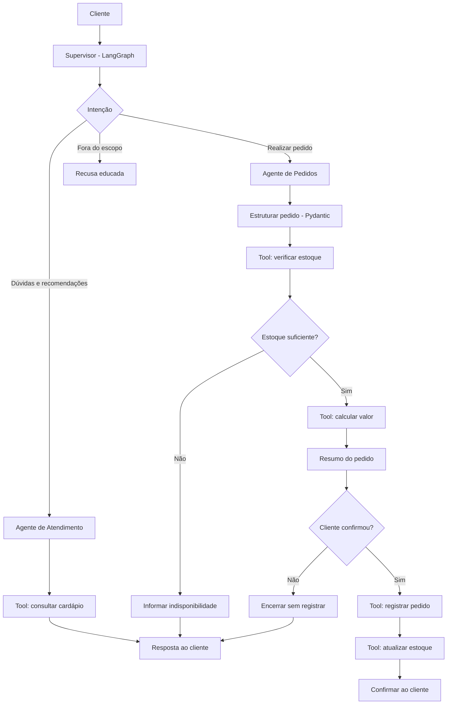

# ☕ Cafeter.IA

Assistente inteligente para **atendimento, pedidos e estoque** de cafeterias, construído com Python, LangChain e LangGraph.

> **Princípio da solução:** a IA interpreta e orienta; as ferramentas executam; o Python valida e calcula; o LangGraph coordena o fluxo.

---

## Sumário

1. [Visão geral](#visão-geral)
2. [Problema de negócio](#problema-de-negócio)
3. [Como funciona](#como-funciona)
4. [Escopo por versão](#escopo-por-versão)
5. [Tecnologias](#tecnologias)
6. [Estrutura do repositório](#estrutura-do-repositório)
7. [Como rodar](#como-rodar)
8. [Cenários de demonstração](#cenários-de-demonstração)
9. [Testes](#testes)
10. [Regras do projeto](#regras-do-projeto)
11. [Equipe](#equipe)
12. [Documentação](#documentação)

---

## Visão geral

O Cafeter.IA entende pedidos em linguagem natural, consulta o cardápio, recomenda produtos, estrutura pedidos, verifica a disponibilidade dos ingredientes, calcula o valor total e só registra o pedido depois da **confirmação humana**.

Na versão completa, o projeto também responde dúvidas de política e receita com **RAG**, analisa o estoque do dia e executa reposições por um **servidor MCP** com versão de estado e idempotência, com um agente comprador e um revisor independente.

## Problema de negócio

Cafeterias lidam todo dia com atendimento, cardápio, pedidos e controle de insumos. Feitas manualmente e sem integração, essas tarefas geram erros nos pedidos, demora no atendimento e falhas no controle de estoque, como vender um item que já acabou.

## Como funciona

Um **supervisor** (LangGraph) identifica a intenção da mensagem e a encaminha ao componente certo.

| Componente | Responsabilidade |
|---|---|
| **Supervisor** | Classifica a intenção, roteia e controla o estado compartilhado |
| **Agente de Atendimento** | Dúvidas sobre o cardápio e recomendações |
| **Agente de Pedidos** | Transforma o pedido em dado estruturado (Pydantic), pede confirmação |
| **Ferramentas de Estoque** | Consultar, verificar, atualizar e alertar estoque baixo (Python determinístico) |
| **RAG** *(versão completa)* | Manual da cafeteria: receitas, alérgenos, validade, políticas |
| **Comprador + Revisor** *(versão completa)* | Propõem e julgam reposições de estoque |
| **Servidor MCP** *(versão completa)* | Porta de entrada das ações sobre o estoque |

### Fluxo do MVP



### Fluxo da versão completa (visão resumida)

```text
START → classify
  atendimento → consultar cardápio → resposta
  pedido      → estruturar → verificar estoque → calcular → confirmação humana → registrar
  regra       → retrieve (manual) → grade → generate  |  nao_encontrado
  analise     → retrieve (estoque) → extract → analyze ⇄ tools → resposta
  acao        → ler_estado (MCP) → comprador → revisor → validar
                  → aprovação do gerente → executar (MCP) → reler | confirmar
  fora_escopo → refuse
```

## Escopo por versão

| Versão | Conteúdo |
|---|---|
| **MVP** | Atendimento, cardápio, recomendação, pedido estruturado, estoque como ferramentas Python, cálculo determinístico, confirmação humana, atualização de estoque |
| **Completa** | MVP + RAG (roteamento, grade, "não encontrado", extração estruturada), análise de estoque com tools, comprador + revisor, servidor MCP (versão de estado e idempotência), aprovação do gerente, Langfuse e avaliação automática |

Fora do escopo: pagamento real, interface gráfica elaborada, banco de dados em produção, previsão de demanda com ML, acompanhamento de entregas.

## Tecnologias

Python · LangChain · LangGraph · Pydantic · Tool calling · RAG (`InMemoryVectorStore`) · FastMCP · Langfuse (opcional) · JSON para dados simulados · pytest

## Estrutura do repositório

```text
Cafeter.IA/
├── README.md
├── .env.example            # modelo de variáveis (copie para .env)
├── .gitignore
├── requirements.txt
├── requirements-dev.txt
├── pyproject.toml
├── docs/                   # passo a passo, contratos e decisões
├── dados/                  # cardápio, estoque, manual, relatório e gabarito (JSON/TXT)
├── mcp_server/             # servidor MCP (serviço separado; versão completa)
├── scripts/                # testar_mcp.py, avaliar.py
├── src/
│   ├── app/                # ponto de entrada (main.py)
│   ├── graph/
│   │   ├── nodes/          # um arquivo por nó do grafo
│   │   └── prompts/        # um arquivo por prompt
│   ├── schemas/            # modelos Pydantic (Pedido, ItemPedido, ...)
│   └── utils/              # llm_adapter, vector_store, mcp_client, langfuse_client
└── tests/                  # testes offline (sem chamar LLM)
```

As pastas começam vazias (cada uma tem um `.gitkeep`, que pode ser apagado quando houver arquivos reais).

## Como rodar

```bash
# 1. Clonar
git clone https://github.com/camimcl/Cafeter.IA.git
cd Cafeter.IA

# 2. Ambiente virtual
python -m venv .venv
source .venv/bin/activate        # Windows: .venv\Scripts\activate

# 3. Dependências
pip install -r requirements-dev.txt

# 4. Configuração
cp .env.example .env             # Windows: copy .env.example .env
# edite o .env e preencha a chave. Nunca faça commit do .env.
```

Execução (disponível conforme as fases do [passo a passo](docs/passo-a-passo.md) forem concluídas):

```bash
python -m src.app.main            # aplicação
python mcp_server/server.py       # servidor MCP, em outro terminal (versão completa)
python -m scripts.avaliar         # avaliação com perguntas de gabarito
```

## Cenários de demonstração

1. **Pedido:** "Quero dois cappuccinos com leite de aveia e um pão de queijo." → estrutura, verifica estoque, calcula, pede confirmação e registra.
2. **Recomendação:** "Quero uma bebida gelada, doce e sem lactose." → consulta o cardápio e sugere opções compatíveis.
3. **Indisponível:** "Quero três cappuccinos com leite de aveia." → estoque insuficiente, nada é registrado.
4. **Regra (completa):** "Qual a validade do leite aberto?" → RAG; se o manual não tiver, responde "Não encontrado".
5. **Reposição (completa):** o agente propõe repor um item, o revisor aprova, o gerente confirma, o MCP executa uma única vez.

## Testes

```bash
pytest
```

Os testes são **offline** (não chamam LLM). Conferem, entre outros pontos: estoque só muda após a confirmação, o cálculo do valor total, quantidades inválidas, cancelamento e perguntas fora do escopo.

## Regras do projeto

- **Sem custos:** apenas modelos gratuitos do OpenRouter (`LLM_MODEL=openrouter/free`; embeddings terminados em `:free`). Limite de cerca de 50 requisições por dia: use os testes offline para economizar.
- **Segredos:** o `.env` nunca entra no Git. Só o `.env.example` é versionado, sem valores reais.
- **Contratos primeiro:** antes de codar, a equipe define o formato de entrada e saída de cada componente (`docs/contratos.md`).
- **Branches:** uma branch por funcionalidade e Pull Request revisado por outra pessoa antes do merge.
- **LLM decide, Python calcula:** valores, estoque e validações nunca ficam a cargo do LLM.

## Equipe

| Integrante | Responsabilidade |
|---|---|
| Pessoa 1 | Arquitetura, supervisor, estado compartilhado e roteamento |
| Pessoa 2 | Agente de Atendimento: prompt, cardápio e recomendações |
| Pessoa 3 | Agente de Pedidos: Pydantic, cálculo e registro |
| Pessoa 4 | Ferramentas de estoque, dados, integração e testes |

*(Substituir pelos nomes reais.)*

## Documentação

- [Passo a passo do projeto](docs/passo-a-passo.md)
