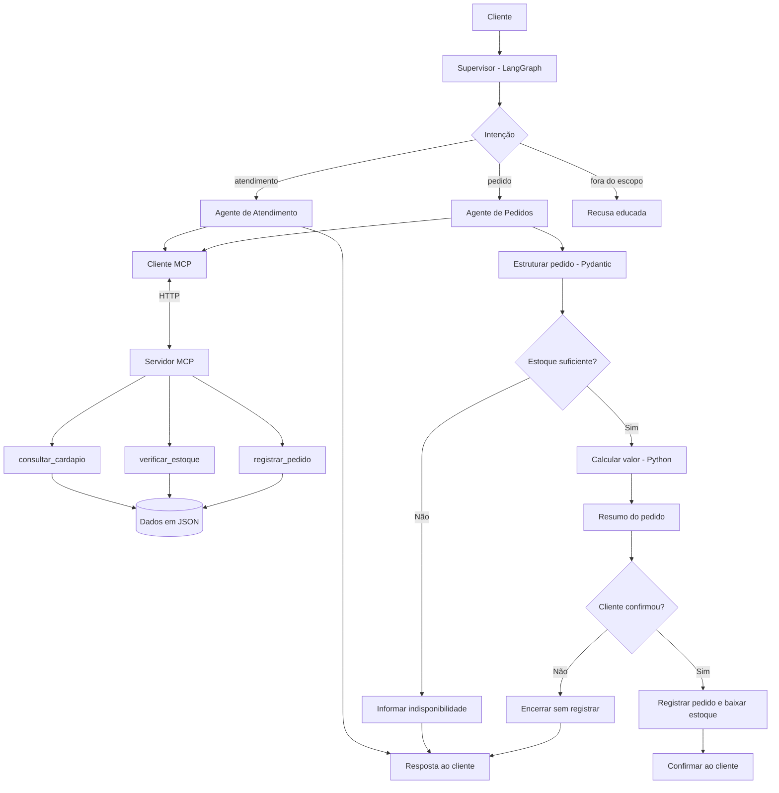

# ☕ Cafeter.IA

Assistente inteligente para **atendimento, pedidos e estoque** de cafeterias, construído com Python, LangChain, LangGraph e **MCP** (Model Context Protocol).

> **Princípio da solução:** a IA interpreta e orienta; as ferramentas executam; o Python valida e calcula; o MCP padroniza a comunicação; o LangGraph coordena o fluxo.

---

## Sumário

1. [Visão geral](#visão-geral)
2. [Problema de negócio](#problema-de-negócio)
3. [Como funciona](#como-funciona)
4. [Escopo](#escopo)
5. [Tecnologias](#tecnologias)
6. [Estrutura do repositório](#estrutura-do-repositório)
7. [Como rodar](#como-rodar)
8. [Cenários de demonstração](#cenários-de-demonstração)
9. [Testes](#testes)
10. [Regras do projeto](#regras-do-projeto)
11. [Equipe](#equipe)
12. [Documentação](#documentação)

---

## Visão geral

O Cafeter.IA entende pedidos em linguagem natural, consulta o cardápio, recomenda produtos, estrutura pedidos, verifica a disponibilidade dos ingredientes, calcula o valor total e só registra o pedido depois da **confirmação humana**.

As operações da cafeteria (consultar cardápio, verificar estoque, registrar pedido) ficam em um **servidor MCP** que roda em um processo separado e conversa com a aplicação por **HTTP local**. A aplicação descobre e chama essas ferramentas por um cliente MCP.

## Problema de negócio

Cafeterias lidam todo dia com atendimento, cardápio, pedidos e controle de insumos. Feitas manualmente e sem integração, essas tarefas geram erros nos pedidos, demora no atendimento e falhas no controle de estoque, como vender um item que já acabou.

## Como funciona

Um **supervisor** (LangGraph) identifica a intenção da mensagem e a encaminha ao agente certo.

| Componente | Responsabilidade |
|---|---|
| **Supervisor** | Classifica a intenção, roteia, controla o estado compartilhado e a confirmação humana |
| **Agente de Atendimento** | Dúvidas sobre o cardápio e recomendações |
| **Agente de Pedidos** | Transforma o pedido em dado estruturado (Pydantic), verifica estoque, calcula o valor e finaliza o registro |
| **Servidor MCP** | Expõe as ferramentas `consultar_cardapio`, `verificar_estoque` e `registrar_pedido` |
| **Cliente MCP** | Conecta a aplicação ao servidor (função única `chamar_ferramenta`) |

### Fluxo principal



### Defesa em camadas (o que fica com o LLM e o que fica com o Python)

| Quem | Faz |
|---|---|
| LLM | Interpreta a mensagem, extrai o pedido, escreve respostas |
| Python | Valida quantidades, calcula o valor, decide se há estoque |
| Servidor MCP | Confere o estoque de novo ao registrar e grava tudo ou nada |
| Cliente (humano) | Confirma antes de qualquer registro |

## Escopo

### MVP (obrigatório)

1. Atendimento por linguagem natural
2. Consulta ao cardápio e recomendação de produtos
3. Identificação e estruturação de pedidos (Pydantic)
4. Consulta à disponibilidade de ingredientes
5. Cálculo determinístico do valor do pedido
6. Confirmação antes do registro (human-in-the-loop)
7. Atualização do estoque após a confirmação
8. Comunicação com as ferramentas via MCP (servidor local em HTTP)

### Depois do MVP (opcional)

RAG sobre um manual da cafeteria, análise de estoque com ferramentas, comprador com revisor, versão de estado e idempotência no servidor MCP, Langfuse e avaliação automática. Detalhes no [passo a passo](docs/passo-a-passo.md#depois-do-mvp-opcional).

### Fora do escopo

Pagamento real, interface gráfica elaborada, banco de dados em produção, integrações externas, previsão de demanda com ML, múltiplos servidores MCP e acompanhamento de entregas.

## Tecnologias

Python · LangChain · LangGraph · Pydantic · Tool calling · FastMCP (servidor) e cliente MCP · JSON para dados simulados · pytest · ruff · Langfuse (opcional)

## Estrutura do repositório

```text
Cafeter.IA/
├── README.md
├── .env.example              # modelo de variáveis (copie para .env)
├── .gitignore
├── requirements.txt
├── requirements-dev.txt
├── pyproject.toml
├── docs/
│   ├── CafeterIA.md                       # visão geral e escopo do projeto
│   ├── passo-a-passo.md                   # guia de implementação em fases
│   ├── divisao-de-responsabilidades.md    # etapas de cada pessoa e contratos
│   ├── padronizacao.md                    # nomes, estilo, Git, testes
│   └── contratos.md                       # formatos de entrada e saída entre componentes
├── dados/                    # cardapio.json, estoque.json, receitas.json, pedidos.json
├── mcp_server/               # servidor MCP (processo separado) e acesso aos dados
├── scripts/                  # testar_mcp.py (teste das ferramentas sem LLM)
├── src/
│   ├── app/                  # main.py (conversa no terminal)
│   ├── graph/
│   │   ├── state.py          # estado compartilhado
│   │   ├── builder.py        # montagem do grafo
│   │   ├── routing.py        # funções de roteamento (route_*)
│   │   ├── nodes/            # um arquivo por nó
│   │   └── prompts/          # um arquivo por prompt
│   ├── schemas/              # modelos Pydantic (Pedido, FiltroCardapio, ...)
│   └── utils/                # llm_adapter, mcp_client, mcp_stub, valores
└── tests/                    # testes offline (sem chamar LLM); e2e/ para os cenários
```

Pastas ainda sem código têm um `.gitkeep`, que pode ser apagado quando houver arquivos reais.

## Como rodar

```bash
# 1. Clonar
git clone https://github.com/camimcl/Cafeter.IA.git
cd Cafeter.IA

# 2. Ambiente virtual
python -m venv .venv
source .venv/bin/activate        # Windows: .venv\Scripts\activate

# 3. Dependências
pip install -r requirements-dev.txt

# 4. Configuração
cp .env.example .env             # Windows: copy .env.example .env
# edite o .env e preencha a chave. Nunca faça commit do .env.
```

A aplicação usa **dois terminais**, porque o servidor MCP é um processo separado:

```bash
# Terminal 1: servidor MCP (HTTP em http://127.0.0.1:8000/mcp)
python mcp_server/server.py

# Terminal 2: aplicação
python -m src.app.main
```

Se o servidor não estiver no ar, a aplicação avisa que o serviço está indisponível e não registra nada.

Para desenvolver sem o servidor, use o *stub* do cliente MCP (respostas fixas): defina `USAR_MCP_STUB=1` no `.env`.

Para testar as ferramentas do servidor sem LLM:

```bash
python -m scripts.testar_mcp
```

> Os comandos ficam disponíveis conforme as fases do [passo a passo](docs/passo-a-passo.md) forem concluídas.

## Cenários de demonstração

1. **Pedido:** "Olá! Gostaria de pedir dois cappuccinos com leite de aveia e um pão de queijo." → estrutura, verifica estoque, calcula, mostra o resumo, pede confirmação e registra.
2. **Recomendação:** "Quero uma bebida gelada, doce e sem lactose. O que vocês recomendam?" → consulta o cardápio e sugere opções compatíveis.
3. **Indisponível:** "Quero três cappuccinos com leite de aveia." → estoque insuficiente; nada é registrado e o estoque não muda.

## Testes

```bash
pytest
```

Os testes são **offline** (não chamam LLM nem a internet). Cobrem: produto existente e inexistente, estoque suficiente e insuficiente, quantidade inválida ou ausente, cancelamento antes da confirmação, pedido confirmado, pergunta fora do escopo, servidor MCP indisponível, falha de ferramenta, **estoque só muda após a confirmação** e valores iguais aos calculados em Python.

## Regras do projeto

- **Padronização:** todos seguem o [guia de padronização](docs/padronizacao.md) (nomes, idioma, estilo, Git, testes).
- **Contratos primeiro:** antes de codar, a equipe fecha os formatos em [`docs/contratos.md`](docs/contratos.md). Mudar contrato exige aprovação de todos.
- **Dono único por arquivo:** só o dono edita; os outros pedem a mudança. A lista está na [divisão de responsabilidades](docs/divisao-de-responsabilidades.md).
- **Sem custos:** apenas modelos gratuitos do OpenRouter (`LLM_MODEL=openrouter/free`; embeddings terminados em `:free`). Limite de cerca de 50 requisições por dia: use testes offline.
- **Segredos:** o `.env` nunca entra no Git. Só o `.env.example` é versionado, sem valores reais.
- **LLM decide, Python calcula:** valores, estoque e validações nunca ficam a cargo do LLM.
- **Git:** uma branch por funcionalidade (`feat/pedidos-estruturar`) e Pull Request aprovado por outra pessoa. Nunca commitar direto na `main` (depois da configuração inicial).

## Equipe

| Integrante | Área | Etapas |
|---|---|---|
| Pessoa 1 | Arquitetura e Supervisor | 1.1 a 1.9: contratos, `State`, `classify`, roteamento, confirmação humana, grafo, `main.py`, tratamento de falhas |
| Pessoa 2 | Agente de Atendimento, cardápio e testes integrados | 2.1 a 2.10: `cardapio.json`, filtros, prompt, recomendação, testes dos cenários, roteiro da demo |
| Pessoa 3 | Agente de Pedidos | 3.1 a 3.8: modelos Pydantic, cálculo de valor, extração do pedido, disponibilidade, resumo, finalização |
| Pessoa 4 | Servidor MCP, dados e cliente | 4.1 a 4.9: dados e receitas, **stub do cliente**, ferramentas, servidor HTTP, cliente real, teste sem LLM |

*(Substituir "Pessoa N" pelos nomes reais.)* O detalhe de cada etapa está em [`docs/divisao-de-responsabilidades.md`](docs/divisao-de-responsabilidades.md).

## Documentação

| Documento | Para quê |
|---|---|
| [CafeterIA.md](docs/CafeterIA.md) | Visão geral, arquitetura e escopo do MVP |
| [passo-a-passo.md](docs/passo-a-passo.md) | Guia de implementação em fases, com marcos |
| [divisao-de-responsabilidades.md](docs/divisao-de-responsabilidades.md) | Etapas por pessoa, donos de arquivos, dependências |
| [padronizacao.md](docs/padronizacao.md) | Idioma, nomes, estilo, erros, Git e testes |
| [contratos.md](docs/contratos.md) | Estado, modelos e ferramentas: entradas e saídas |
