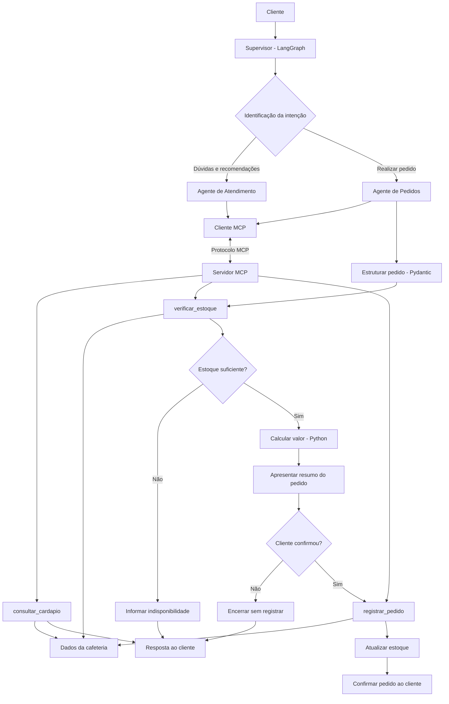

# ☕ CafeterIA — Assistente Inteligente para Gestão e Atendimento de Cafeterias

## 1. Visão geral

O CafeterIA é um sistema inteligente para cafeterias que integra atendimento ao cliente, gerenciamento de pedidos e controle de estoque utilizando Inteligência Artificial.

A proposta é desenvolver um assistente capaz de compreender solicitações dos clientes, consultar o cardápio, recomendar produtos, registrar pedidos e verificar a disponibilidade dos ingredientes.

O sistema utilizará Python, LangChain, LangGraph e MCP (Model Context Protocol) para estruturar os agentes, controlar o fluxo de execução e integrar ferramentas responsáveis pelas operações da cafeteria.

## 2. Problema de negócio

Cafeterias precisam lidar diariamente com diferentes atividades:

- Atendimento e esclarecimento de dúvidas dos clientes;
- Apresentação do cardápio e recomendações de produtos;
- Registro e acompanhamento de pedidos;
- Controle da disponibilidade de produtos e ingredientes;
- Prevenção de pedidos de itens indisponíveis.

Quando essas atividades são realizadas manualmente e sem integração, podem ocorrer erros nos pedidos, demora no atendimento e dificuldades no controle de estoque.

**Dor do cliente:** necessidade de melhorar a experiência de atendimento e integrar as informações comerciais e operacionais da cafeteria, reduzindo erros e facilitando a tomada de decisões.

## 3. Solução proposta

Desenvolver um assistente inteligente composto por um supervisor, agentes especializados e um servidor MCP que disponibilizará ferramentas para as operações da cafeteria.

### Componente 1 — Supervisor

Responsável por coordenar o fluxo de execução.

- Receber a solicitação do cliente;
- Identificar a intenção da mensagem;
- Encaminhar a solicitação ao componente adequado;
- Controlar o fluxo de execução;
- Retornar a resposta ao cliente.

### Componente 2 — Agente de Atendimento

Responsável pela interação com o cliente.

- Responder dúvidas sobre o cardápio;
- Consultar ingredientes e características dos produtos;
- Recomendar bebidas e alimentos de acordo com as preferências do cliente;
- Identificar quando o cliente deseja realizar um pedido.

Exemplo:

"Quero uma bebida gelada, doce e sem lactose. O que vocês recomendam?"

O agente consulta as informações do cardápio e apresenta opções compatíveis.

### Componente 3 — Agente de Pedidos

Responsável por transformar a solicitação do cliente em um pedido estruturado.

- Identificar produtos, quantidades e personalizações;
- Estruturar os pedidos utilizando Pydantic;
- Consultar a disponibilidade dos ingredientes;
- Calcular o valor total utilizando Python;
- Solicitar confirmação antes de registrar o pedido.

Exemplo:

"Quero dois cappuccinos com leite vegetal e um pão de queijo."

O agente estrutura o pedido, verifica a disponibilidade e solicita a confirmação.

### Componente 4 — Servidor MCP

Responsável por disponibilizar as ferramentas da cafeteria através do Model Context Protocol.

O servidor MCP disponibilizará inicialmente três ferramentas:

| Ferramenta | Responsabilidade |
|---|---|
| `consultar_cardapio` | Consultar produtos, preços e ingredientes |
| `verificar_estoque` | Verificar a disponibilidade dos ingredientes |
| `registrar_pedido` | Registrar o pedido confirmado e atualizar o estoque |

O agente utilizará um cliente MCP para descobrir e executar essas ferramentas.

**Decisão arquitetural:** as regras de negócio, como cálculo de valores e validação de quantidades, continuarão sendo executadas em Python. O MCP será responsável por padronizar a comunicação entre a aplicação e as ferramentas.

## 4. Arquitetura e fluxograma

O LangGraph será responsável por organizar o fluxo de execução, controlar os estados e direcionar as solicitações.

O MCP será utilizado como camada de integração com as ferramentas da cafeteria.

### Fluxograma principal

### Explicação do fluxo

**1. Recebimento da solicitação**

O cliente envia uma mensagem em linguagem natural.

**2. Identificação da intenção**

O supervisor identifica se o cliente deseja consultar o cardápio, receber recomendações ou realizar um pedido.

**3. Encaminhamento**

A solicitação é encaminhada ao agente de atendimento ou ao agente de pedidos.

**4. Comunicação com o MCP**

Os agentes utilizam o cliente MCP para acessar as ferramentas disponibilizadas pelo servidor.

**5. Execução das ferramentas**

O servidor MCP disponibiliza as operações de consulta ao cardápio, verificação de estoque e registro de pedidos.

**6. Validação e confirmação**

Se houver disponibilidade, o sistema calcula o valor do pedido e apresenta um resumo ao cliente, aguardando sua confirmação.

**7. Registro e atualização**

Após a confirmação, a ferramenta MCP registra o pedido e atualiza o estoque.

**8. Retorno**

O sistema apresenta a resposta final ao cliente.

### Responsabilidades técnicas

| Componente | Responsabilidade |
|---|---|
| LangGraph | Orquestrar o fluxo e controlar o estado compartilhado |
| Supervisor | Identificar a intenção e encaminhar solicitações |
| LLM | Interpretar linguagem natural e gerar respostas |
| Pydantic | Validar e estruturar os dados dos pedidos |
| Cliente MCP | Conectar a aplicação ao servidor MCP e disponibilizar suas ferramentas |
| Servidor MCP | Expor as ferramentas da cafeteria |
| Python | Executar cálculos e regras de negócio |
| Human-in-the-loop | Aguardar confirmação antes de registrar o pedido |

## 5. Tecnologias previstas

- **Python:** linguagem principal da aplicação.
- **LangChain:** integração com modelos de linguagem e ferramentas.
- **LangGraph:** construção do fluxo de execução e roteamento condicional.
- **LLM:** interpretação das solicitações e geração de respostas.
- **Pydantic:** validação e estruturação dos pedidos.
- **MCP:** padronização da comunicação entre a aplicação e as ferramentas.
- **JSON:** armazenamento simplificado dos dados simulados.
- **Langfuse (opcional):** observabilidade e acompanhamento das execuções.

Não será necessário implementar um banco de dados completo ou integrações externas no primeiro protótipo.

## 6. Divisão de responsabilidades — equipe de quatro pessoas

| Integrante | Responsabilidade | Entregáveis |
|---|---|---|
| Pessoa 1 | Arquitetura e Supervisor | Estado compartilhado, fluxo principal e roteamento |
| Pessoa 2 | Agente de Atendimento | Prompt, consulta ao cardápio e recomendações |
| Pessoa 3 | Agente de Pedidos | Pydantic, cálculo de valores e integração com as ferramentas MCP |
| Pessoa 4 | Servidor MCP e dados | Implementação das ferramentas, dados de estoque e cardápio, registro e atualização dos pedidos |

Todos devem definir previamente os formatos de entrada e saída de seus componentes para facilitar a integração.

## 7. Escopo do MVP

### Funcionalidades obrigatórias

1. Atendimento por linguagem natural;
2. Consulta ao cardápio;
3. Recomendação de produtos;
4. Identificação e estruturação de pedidos;
5. Consulta à disponibilidade de ingredientes;
6. Cálculo determinístico do valor do pedido;
7. Confirmação antes do registro;
8. Atualização do estoque após a confirmação;
9. Comunicação com as ferramentas através do MCP.

### Funcionalidades fora do escopo inicial

- Integração com sistemas reais de pagamento;
- Aplicativo ou interface gráfica elaborada;
- Banco de dados em produção;
- Integração com sistemas externos;
- Previsão de demanda com Machine Learning;
- Múltiplos servidores MCP;
- Sistema completo de acompanhamento de entregas;
- Langfuse, caso o tempo de desenvolvimento seja insuficiente.

Essas funcionalidades poderão ser consideradas em versões futuras.

## 8. Etapas de desenvolvimento

1. Definição dos requisitos, arquitetura e contratos entre componentes;
2. Desenvolvimento individual dos agentes e do servidor MCP;
3. Implementação das ferramentas e preparação dos dados simulados;
4. Integração do cliente MCP com o LangGraph;
5. Implementação complementar e correção de problemas;
6. Testes integrados e validação dos cenários;
7. Preparação da apresentação e demonstração.

## 9. Cenários de demonstração

### Cenário 1 — Realização de pedido

**Cliente:**

"Olá! Gostaria de pedir dois cappuccinos com leite de aveia e um pão de queijo."

**Execução esperada:**

1. O supervisor identifica a intenção de realizar um pedido.
2. O agente de pedidos interpreta a solicitação.
3. O pedido é estruturado utilizando Pydantic.
4. O agente consulta a ferramenta `verificar_estoque` através do MCP.
5. Python calcula o valor total.
6. O sistema apresenta o resumo e solicita confirmação.
7. Após a confirmação, o agente utiliza `registrar_pedido`.
8. O servidor MCP registra o pedido e atualiza o estoque.
9. O sistema retorna a confirmação ao cliente.

### Cenário 2 — Recomendação de produto

**Cliente:**

"Quero uma bebida gelada, doce e sem lactose. O que vocês recomendam?"

**Execução esperada:**

1. O supervisor identifica uma solicitação de recomendação.
2. O agente de atendimento utiliza `consultar_cardapio` através do MCP.
3. O agente identifica produtos compatíveis com as preferências.
4. O sistema apresenta as opções ao cliente.

### Cenário 3 — Produto indisponível

**Cliente:**

"Quero três cappuccinos com leite de aveia."

**Execução esperada:**

1. O pedido é estruturado.
2. O agente consulta o estoque através do MCP.
3. A ferramenta identifica que não existem ingredientes suficientes.
4. O sistema informa a indisponibilidade.
5. O pedido não é registrado nem o estoque é alterado.

## 10. Testes e validação

O protótipo deverá ser testado considerando:

- Solicitação de produtos existentes;
- Solicitação de produtos inexistentes;
- Estoque suficiente;
- Estoque insuficiente;
- Quantidade inválida ou não informada;
- Cancelamento antes da confirmação;
- Pedido confirmado;
- Perguntas fora do escopo da cafeteria;
- Indisponibilidade do servidor MCP;
- Falhas na execução de ferramentas.

Também será necessário verificar se o estoque só é atualizado após a confirmação e se os valores calculados correspondem às regras definidas em Python.

## 11. Viabilidade da implementação do MCP

A implementação do MCP é viável para o projeto, desde que seja limitada a um servidor local e a três ferramentas principais.

### Por que utilizar MCP?

O MCP permite separar a aplicação que utiliza as ferramentas do serviço que disponibiliza essas ferramentas.

No CafeterIA:

- O LangGraph coordena o fluxo;
- Os agentes identificam quais operações precisam executar;
- O cliente MCP estabelece a comunicação;
- O servidor MCP disponibiliza as ferramentas;
- As ferramentas executam as operações sobre os dados da cafeteria.

### Estratégia de implementação

Para manter o projeto viável:

- Utilizar apenas um servidor MCP;
- Utilizar transporte HTTP local, com o servidor MCP rodando em outro terminal (por exemplo, em `http://127.0.0.1:8000/mcp`, endereço lido da variável `MCP_URL`);
- Implementar somente três ferramentas;
- Armazenar os dados em JSON;
- Não utilizar autenticação ou infraestrutura externa no protótipo;
- Testar o servidor MCP independentemente antes de integrá-lo ao LangGraph.

### Plano alternativo

Caso a integração MCP apresente problemas, as ferramentas poderão ser chamadas diretamente pelo Python, preservando a arquitetura principal e garantindo a entrega do MVP.

O MCP deverá ser considerado um diferencial da implementação, mas não um requisito que impeça a conclusão do sistema.

## 12. Resultado esperado

Ao final do desenvolvimento, espera-se ter um protótipo funcional de uma cafeteria inteligente, demonstrando como agentes especializados podem trabalhar em conjunto para integrar atendimento, pedidos e operações.

O projeto permitirá demonstrar conhecimentos de:

- Engenharia de soluções;
- Arquitetura de agentes;
- Orquestração com LangGraph;
- Roteamento condicional;
- Integração de ferramentas;
- Structured Output e Pydantic;
- Human-in-the-loop;
- Model Context Protocol (MCP);
- Separação entre decisões realizadas por LLMs e regras determinísticas executadas em Python.

**Princípio da solução:** a Inteligência Artificial interpreta e orienta; as ferramentas executam; Python valida e calcula; o MCP padroniza a comunicação; e o LangGraph coordena o fluxo.