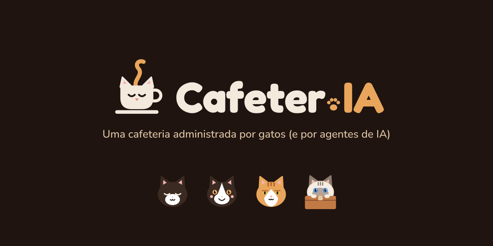
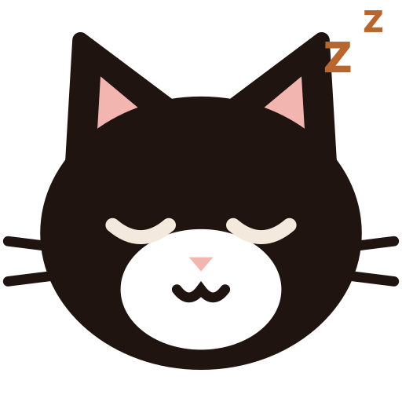
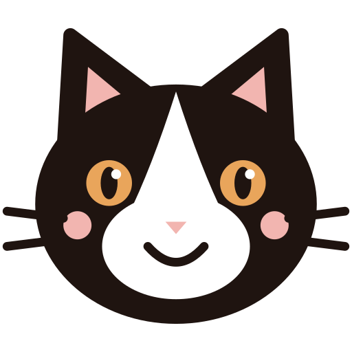
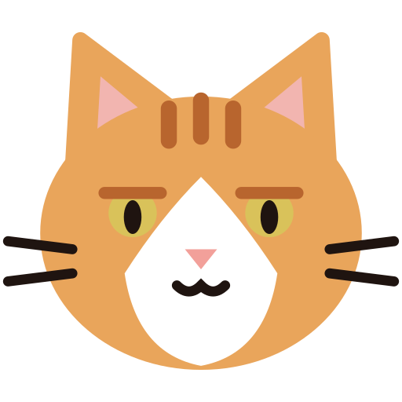
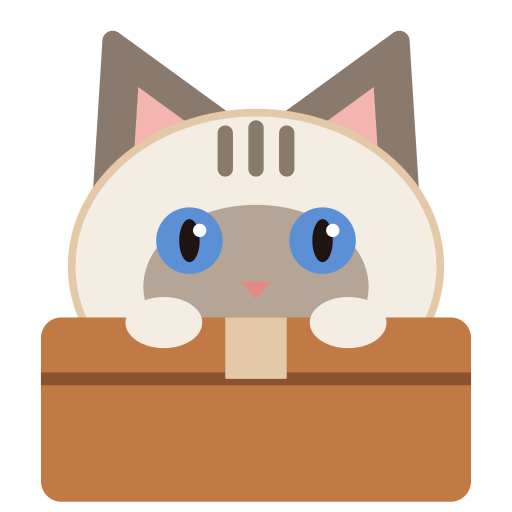

# Cafeter.IA — Identidade visual



> Uma cafeteria administrada por gatos (e por agentes de IA).

## Conceito

O símbolo é uma **xícara-gato dormindo**: as orelhas saem da borda da xícara e o **rabo sobe como se fosse o vapor do café**. O gato preto dorminhoco é uma referência ao Senhor Mideis, o supervisor que dorme durante as reuniões. No nome, o ponto de **Cafeter.IA** virou uma **patinha**.

## Arquivos

| Pasta | Conteúdo |
|---|---|
| `logo/` | SVGs do logo (horizontal, vertical, negativo, mono), símbolo, ícone de app, `favicon.svg` e `favicon.ico` |
| `png/` | Versões em PNG com fundo transparente, ícone 512 px, `apple-touch-icon.png` e favicon 32 px |
| `mascotes/` | Os quatro gatos-agentes em SVG e PNG (512 px) |
| `banner/` | Banner 1280×640 para o *social preview* do GitHub e para o topo do README |
| `cores.css` | Cores, fontes e classes básicas como variáveis CSS |

O texto dos SVGs está **convertido em curvas**, então o logo aparece igual em qualquer lugar, mesmo sem as fontes instaladas.

## Logo

| Versão | Quando usar |
|---|---|
| `logo-horizontal.svg` | Padrão, em fundo claro (creme ou branco) |
| `logo-horizontal-negativo.svg` | Em fundo escuro (espresso) |
| `logo-vertical.svg` / `logo-vertical-negativo.svg` | Espaços quadrados ou estreitos |
| `logo-horizontal-mono.svg` / `-mono-branco.svg` | Impressão em uma cor e carimbos |
| `simbolo.svg` | Só o símbolo, quando o nome já aparece por perto |
| `icone-app.svg` / `favicon.*` | Ícone de app, aba do navegador e avatar do repositório |

**Cuidados:** não distorcer, não girar e não trocar as cores fora da paleta. Deixe em volta do logo um espaço livre de pelo menos a largura da orelha do gato. Tamanho mínimo: 120 px de largura para o horizontal e 24 px para o símbolo.

## Cores

| Nome | Hex | Uso |
|---|---|---|
| Espresso | `#1F1410` | Texto, símbolo, fundos escuros |
| Âmbar | `#E9A55B` | Destaque em fundo escuro, ícone |
| Caramelo | `#B8652E` | Destaque em fundo claro, ".IA", rabo |
| Creme | `#F3E9DC` | Fundo principal |
| Latte | `#E3C9A8` | Bordas, cartões, divisórias |
| Rosa-patinha | `#F2B5B0` | Detalhes: orelhas, nariz, avisos |
| Cacau | `#5C4434` | Texto secundário |

Contraste: em fundo claro, use **Caramelo** (não Âmbar) para texto colorido. Em fundo escuro, use **Âmbar** ou **Creme**.

## Tipografia

- **Fredoka** (Bold/SemiBold): logo, títulos, botões e nomes dos mascotes
- **Nunito** (Medium/Bold): textos e interface
- **JetBrains Mono** (Medium): logs dos agentes, status e códigos de pedido

Todas são gratuitas no Google Fonts. O `cores.css` já faz o import.

## Mascotes (um gato por agente)

| | Nome | Agente | Cor | Personalidade |
|---|---|---|---|---|
|  | **Senhor Mideis** | Supervisor | Espresso | Gerente preto e branco. Dorme durante as reuniões |
|  | **Inbonha** | Atendimento | Rosa-patinha | Frajola simpática, conquista os clientes e tenta vender leite |
|  | **Simba** | Pedidos | Âmbar | Laranja e branco, perfeccionista. Cada pedido é uma missão |
|  | **Ariela** | Estoque (MCP) | Caramelo | Gata clara de olhos azuis que esconde os ingredientes |

A cor de cada agente aparece no chip ao lado do nome, nos logs e nas telas. Assim dá para ver de longe quem está falando.

## Tom de voz

As mensagens do sistema seguem a personalidade de cada gato:

```
[Senhor Mideis · Supervisor]  zzz… respondo depois do cochilo.
[Inbonha · Atendimento]       Olá! Que tal um capumiau hoje? Com leite extra, claro.
[Simba · Pedidos]             Missão #042 registrada: 2 capumiaus, 1 pata-chino.
[Ariela · Estoque]            Leite em estoque: 12 unidades… ou 9. Difícil dizer.
```

## Como usar no repositório

No topo do `README.md` do projeto:

```markdown
<p align="center">
  
</p>
```

Para o logo trocar sozinho entre tema claro e escuro do GitHub:

```markdown
<picture>
  <source media="(prefers-color-scheme: dark)" srcset="docs/brand/logo/logo-horizontal-negativo.svg">
  
</picture>
```

**Social preview:** em *Settings → General → Social preview*, envie `banner/banner-github.png`.

**Favicon em HTML:**

```html
<link rel="icon" href="/favicon.svg" type="image/svg+xml">
<link rel="icon" href="/favicon.ico" sizes="any">
<link rel="apple-touch-icon" href="/apple-touch-icon.png">
```
